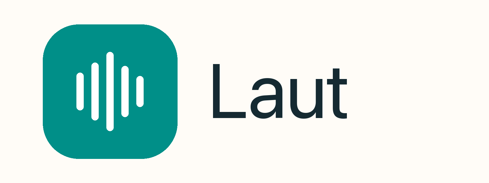

<p align="center">
  
</p>

# Laut

[](https://github.com/seutech/laut-app/actions/workflows/portable.yml)
[](https://github.com/seutech/laut-app/releases)
[](LICENSE)

**Local-first transcription and conference research for macOS, Windows and Linux.**

Laut imports recordings or public YouTube videos, transcribes speech locally, separates speakers, links useful PDF slides and turns long events into a searchable research archive. Audio, transcripts, corrections, notes and model output remain on your computer. No account, cloud transcription, analytics or API key is required.

The current application is written in **Rust** with egui. It is a public alpha: the Mac build is used for real transcript work, while Windows and Linux packages are built and checked in CI but still need wider hardware testing.

## Download

Download the newest package from [GitHub Releases](https://github.com/seutech/laut-app/releases).

| Platform | Package | Current validation |
| --- | --- | --- |
| macOS 13+, Apple Silicon | `Laut-macOS-ARM64.zip` | Main tested desktop build. File/YouTube transcription, editing, playback and local research exercised. |
| Windows 10/11 x64 | `Laut-Windows-X64.zip` | CPU build and automated tests; real microphones, meeting loopback and broad device coverage still need external testing. |
| Linux x64 | `Laut-Linux-X64.tar.gz` | CPU build and automated tests; microphone/device coverage is limited and system-audio capture is not implemented. |

Download the matching `.sha256` file as well. From the download folder, verify macOS with `shasum -a 256 -c Laut-macOS-ARM64.zip.sha256` or Linux with `sha256sum -c Laut-Linux-X64.tar.gz.sha256`. On Windows, compare `(Get-FileHash .\Laut-Windows-X64.zip -Algorithm SHA256).Hash` with the first value in `Laut-Windows-X64.zip.sha256`. Then extract the archive and start `Laut.app`, `Laut.exe` or `./Laut` respectively.

The alpha packages are not code-signed or notarized. macOS users can Control-click **Laut.app** and choose **Open** after checking the downloaded archive. Windows may identify the package as coming from an unknown publisher. If your organization blocks unsigned programs, build Laut from source or wait for signed releases.

Laut needs local **FFmpeg** and **FFprobe** for imports, waveform generation, recording files and non-1× playback. Install them with your normal package manager and let Laut find them, or choose both executables under **Models → Local programs**:

- macOS: `brew install ffmpeg`
- Windows: install an FFmpeg build from [ffmpeg.org](https://ffmpeg.org/download.html) and select `ffmpeg.exe` plus `ffprobe.exe`
- Debian/Ubuntu: `sudo apt install ffmpeg poppler-utils tesseract-ocr`

## First run

1. Open **Settings** and choose or create a library folder.
2. Open **Models** and install Whisper Base or Whisper Small Q5. Model downloads are explicit, checksum-verified and resumable.
3. Ensure FFmpeg and FFprobe are detected under **Local programs**.
4. Import an audio/video file, or add a public YouTube link under **Sources & jobs**.
5. Start the queued job. Completed five-minute chunks are checkpointed so long transcriptions can resume.
6. Review the transcript and speaker assignments before publication. Speaker labels and contextual name suggestions are evidence for editing, not biometric identity claims.

YouTube support uses pinned local yt-dlp and Deno packages installed from the model manager. Laut imports audio only. Use it only for material you are permitted to download and follow the source platform's terms and applicable law.

## What Laut can do

- Local Whisper.cpp transcription on CPU with word timing where the model evidence supports it.
- Persistent multi-file and YouTube job queue with cancellation, checkpoints and verified cache cleanup.
- Local CPU speaker diarization through sherpa-onnx, including reviewable voice samples and protected manual names.
- A readable transcript workspace with paragraphs, speaker/time markers, chapters, search, full-text copy, waveform, zoom and pitch-preserving 0.5×–2× playback.
- Transcript correction, segment splitting/merging, speaker reassignment and saved undo/redo history.
- TXT, Markdown, SRT and complete JSON export.
- Local microphone and meeting capture, with separate microphone/system tracks where the operating system supports it.
- PDF text extraction, optional OCR, page previews and conservative slide suggestions linked to transcript times.
- Reversible exclusion of announced video inserts from the reading/export view while retaining the source evidence.
- Literal and multilingual semantic search across transcripts, notes, saved analysis and PDF pages.
- Local Qwen/llama.cpp analysis with source-linked results and no cloud fallback.
- Verified project copies, library backups, recovery drafts and a reversible library trash.
- German and English interface.

The detailed workflow and CLI reference are in [portable/README.md](portable/README.md). The exact test evidence and open limitations are recorded in [portable/VALIDATION.md](portable/VALIDATION.md); planned work is tracked in [portable/ROADMAP.md](portable/ROADMAP.md).

## Privacy and storage

Laut does not upload recordings or transcript content. Network access is used only when you explicitly download a model/program or import a URL. Local external executables are invoked without a cloud fallback; Laut cannot impose a system-wide firewall on arbitrary binaries you select yourself.

Default data locations retain the earlier `LautPortable` names for compatibility:

| Platform | Library | Settings, drafts, queues and model cache |
| --- | --- | --- |
| macOS | `~/Library/Application Support/LautPortable` | `~/Library/Application Support/LautPortableState` |
| Windows | `%LOCALAPPDATA%\LautPortable` | `%LOCALAPPDATA%\LautPortableState` |
| Linux | `$XDG_DATA_HOME/laut-portable` | `$XDG_DATA_HOME/laut-portable-state` |

Recordings and PDFs can be much larger than transcripts. Temporary download and inference files remain until a completed job's permanent audio is verified and you choose **Remove temporary files**. Keep a separate backup of important source media and the Laut library.

## Known limits in the first public alpha

- Windows and Linux packages have not yet had the same real-device coverage as macOS.
- macOS meeting system audio still needs a successful permission/hardware retest; ordinary file and YouTube work does not depend on it.
- A complete seven-hour conference run, abrupt power-loss behavior and disk-full behavior still need final real-world measurement.
- Linux system-audio recording, acoustic echo cancellation, video-frame slide detection and automatic semantic chapter generation are not implemented.
- Name spelling, speaker clusters, summaries, slide matches and OCR require editorial review.
- The application and release archives are currently unsigned.

Please report reproducible problems through [GitHub Issues](https://github.com/seutech/laut-app/issues). Security-sensitive reports should follow [SECURITY.md](SECURITY.md).

## Build from source

Rust is pinned in [`portable/rust-toolchain.toml`](portable/rust-toolchain.toml). Install Git, rustup, Python 3.12+, CMake, a C/C++ compiler and the platform development packages used in [the CI workflow](.github/workflows/portable.yml).

```sh
git clone https://github.com/seutech/laut-app.git
cd laut-app
bash scripts/portable-cargo.sh test --workspace --locked
bash scripts/portable-cargo.sh run --release -p laut-portable
```

To build the bundled CPU workers and the macOS app:

```sh
python3 portable/scripts/build-whisper.py
python3 portable/scripts/build-llama.py
bash scripts/build-portable-app.sh
open dist/Laut.app
```

The worker scripts download pinned upstream source archives, verify SHA-256 hashes and compile CPU-only binaries. End users of a release package do not need Python or CMake. FFmpeg/FFprobe remain separate because redistribution rules depend on the chosen build.

Project checks:

```sh
bash scripts/portable-cargo.sh fmt --all -- --check
bash scripts/portable-cargo.sh test --workspace --locked
bash scripts/portable-cargo.sh clippy --workspace --all-targets --locked -- -D warnings
python3 portable/check-layers.py
```

## Architecture

```text
desktop (egui + local audio)      CLI (batch / JSON commands)
                 \                 /
                 engine (files, workers, jobs)
                              |
                 core (documents, edits, projections)
```

`laut-core` and `laut-engine` remain independent of the desktop/audio-device layer. Authoritative `recording.json` files retain unknown fields and original evidence while the UI works through typed projections and explicit commands.

The earlier SwiftUI implementation remains in `Sources/` for compatibility testing and migration reference. New product development and public releases use the Rust workspace under `portable/`.

## Contributing and license

See [CONTRIBUTING.md](CONTRIBUTING.md) before sending a change. Laut is licensed under the [MIT License](LICENSE). Downloaded models, external programs and Rust/Swift dependencies retain their own licenses; see [THIRD_PARTY.md](THIRD_PARTY.md) and the model catalog.
